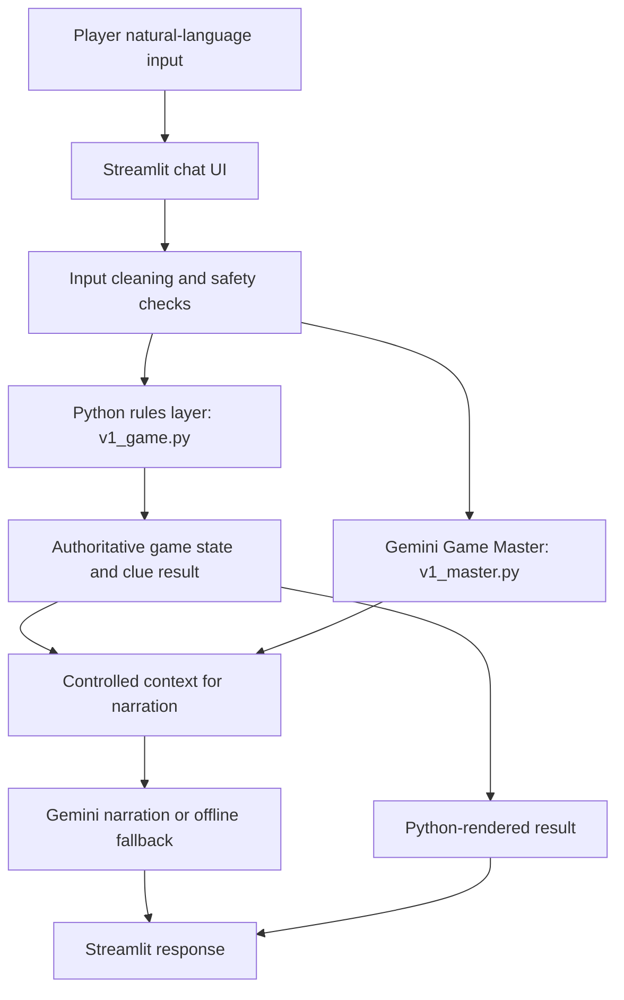
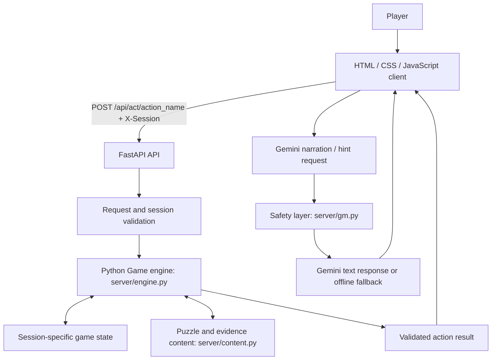
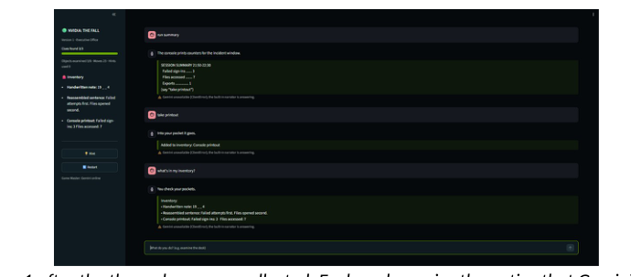
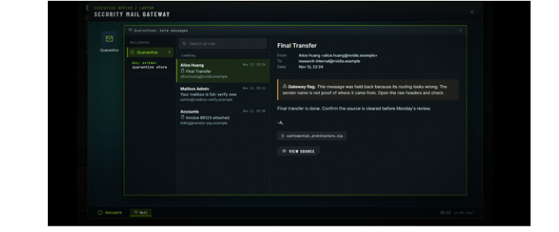
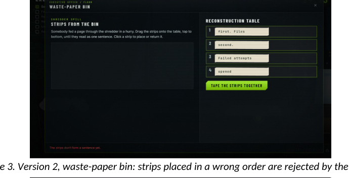
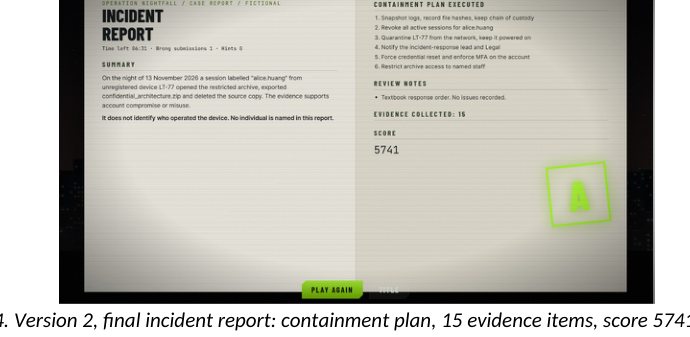

# NVIDIA: THE FALL — The CEO's Last Chance

**AI Escape Room | MSc Data Science | Athiqur Rahman M**

A cyber-forensics escape room in which the player investigates a fictional corporate security incident, gathers evidence, reconstructs events and selects a safe containment response.

> **Core design principle:** Gemini may narrate and provide hints; Python controls game state, puzzle validation and outcomes.

All characters, accounts, devices, logs and events in the gameplay are fictional. This project does not describe or allege a real NVIDIA security incident.

## Project at a glance

| Area | Version 1 | Version 2 |
|---|---|---|
| Interface | Streamlit chat | Point-and-click HTML/CSS/JavaScript |
| Backend / rules | Python rules layer | FastAPI + deterministic Python game engine |
| Player interaction | Natural-language commands parsed with regular expressions | Clickable scenes and dedicated tools |
| Game scope | Executive Office; 6 objects; 3 clues | 3 rooms; 16 JavaScript components plus Web Audio |
| Game state | In-memory session state | Session-specific server-side state, saved as JSON |
| Gemini role | Narration | Narration / hint companion |
| Rule authority | Python | Python |

## Learning objectives

- Inspect synthetic evidence instead of jumping to conclusions.
- Derive the five-digit archive recovery code from multiple clues.
- Correlate account activity, device identity, network information and corrected CCTV time.
- Distinguish account activity from proof of the human operator's identity.
- Build an evidence-supported incident timeline and containment plan.
- Understand why an LLM should not be the authority for game rules or security decisions.

## Story and gameplay

The fictional incident is dated 13 November 2026. The player acts as an investigator and works through three connected rooms in Version 2:

1. **Executive Office** — inspect the desk, wastebasket, laptop, hallway camera and email application. The recovery code is assembled from a desk memo (`19 _ _ 4`), a console summary (3 failed sign-ins and 7 files opened), and shredded-paper instructions. The resulting code is `19374`.
2. **Digital Forensics Lab** — examine 28 audit-log entries, compare device fingerprints with the asset database, inspect network paths and correct the camera clock. The evidence points to an unregistered temporary device, LT-77, being used with the `alice.huang` account.
3. **Incident Room** — connect evidence, reconstruct the timeline, classify eight findings as supported or unsupported, and select a containment strategy.

A key teaching point is that **account activity does not establish the identity of the person operating the device**. The game rewards evidence-based reasoning, not unsupported accusations.

## Architecture

### Version 1



### Version 2



The diagrams describe the architecture documented in the project report. Gemini returns text only; its output is not interpreted as an instruction to mutate game state. See [`docs/ARCHITECTURE.md`](docs/ARCHITECTURE.md).

## Visual evidence

The following figures are extracted from Figures 1–4 on page 5 of the submitted report:

| Version 1 — completed Executive Office | Version 2 — security mail gateway |
|---|---|
|  |  |

| Version 2 — paper-strip puzzle | Version 2 — final incident report |
|---|---|
|  |  |

## Technologies

- Python 3
- Streamlit
- FastAPI and Uvicorn
- HTML, CSS and vanilla JavaScript (ES modules)
- Google Gemini via `google-genai`
- pytest, httpx and Streamlit AppTest
- Google Colab

## Repository layout

```text
.
├── baseline_demo/       # Deliberately vulnerable baseline for comparison
├── colab/               # Colab notebook / project launcher
├── docs/
│   ├── NVIDIA-TheFallProject-Report.pdf
│   ├── ARCHITECTURE.md
│   ├── TEST_CASES.md
│   ├── SECURITY.md
│   └── screenshots/
├── server/              # V2 API, game engine, content and Gemini safety layer
├── static/              # V2 browser client
├── streamlit_app/       # V1 Streamlit implementation
├── tests/               # Automated tests
├── .env.example         # Environment-variable template; no real secret
├── .gitignore
├── requirements.txt
└── run.py
```

## Setup and running

The project was developed and demonstrated in Google Colab. The supplied Colab notebook is the intended reproducible entry point: it uploads and verifies the project ZIP, installs dependencies, runs the automated test suite, and only proceeds to launch a version if the tests pass.

1. Open the project notebook in `colab/` using Google Colab.
2. Add your Gemini key to Colab **Secrets** under the name `GEMINI_API_KEY` (optional for offline fallback).
3. Run the notebook cells in order.
4. Select and launch Version 1 or Version 2 using the notebook's provided flow.

For local development, create a virtual environment, install `requirements.txt`, and follow the launch instructions in the notebook. The exact app entry points are kept in the supplied project launcher rather than duplicated here.

### Environment variables

Copy `.env.example` to `.env` only for local development and add your own key. Never commit `.env`.

```dotenv
GEMINI_API_KEY=your-key-here
GEMINI_MODEL=gemini-2.5-flash
PORT=8000
```

## Testing

The project report records **125 automated tests passed, 0 failed and 0 skipped**, in under three seconds on the reported run. Tests replace Gemini with scripted test doubles, so they do not require a live API key and are reproducible. See [`docs/TEST_CASES.md`](docs/TEST_CASES.md) for representative scenarios and the reported test-file breakdown.

The report also records browser testing of Version 2 (including drag-and-drop and email search) and a full Version 1 playthrough. Re-run the suite before making a new claim about the current repository state.

## Results documented in the report

| Metric | Version 1 | Version 2 |
|---|---:|---:|
| Outcome | Archive door opened | Mission completed |
| Grade | A | A |
| Score | 785 | 5741 |
| Gameplay evidence | 3/3 clues, 25 moves, 0 hints | 15 evidence items, 1 wrong submission, 0 hints, 06:31 remaining |

**Gemini limitation:** In the documented final Version 1 run, Gemini requests failed with `ClientError`; the built-in offline narrator responded instead. The game rules and gameplay still worked. The report notes that the Version 1 sidebar may say “Gemini online” when a key is present even if requests fail.

## Security and responsible AI

- Python, not Gemini, is authoritative for game state and puzzle outcomes.
- Gemini has no tools and returns narration text only.
- Player input is cleaned and limited to 400 characters before model use.
- Regular-expression checks reject known prompt-injection patterns.
- The model receives a controlled, read-only summary rather than hidden puzzle solutions.
- Output screening rejects responses that reveal the code or claim protected game state changed.
- Gemini requests are rate-limited to one every 1.2 seconds and 80 per session.
- A rule-based offline narrator allows gameplay to continue when Gemini fails.
- Version 2 validates session IDs, action names and request-body size (20 KB limit).
- The Gemini API key is supplied through Colab Secrets or an environment variable; it must never be committed.

These measures reduce risk but do not make prompt-injection detection perfect. The strongest safeguard is architectural separation: model text cannot directly change the game state. More detail: [`docs/SECURITY.md`](docs/SECURITY.md).

## Limitations and future work

- Gemini did not respond during the final Version 1 run; the offline narrator was used.
- The Version 1 natural-language parser is regex-based and may not recognise unusual phrasing.
- Regex prompt-injection detection can miss creatively phrased attacks.
- The Version 2 visuals are stylised illustrations and sound is generated in the browser.
- Future work includes structured JSON action proposals validated by Python, Gemini-assisted log explanations using redacted context, a user study and SQLite session storage.

## References

- [Streamlit documentation](https://docs.streamlit.io/)
- [FastAPI documentation](https://fastapi.tiangolo.com/)
- [Google Gemini API documentation](https://ai.google.dev/gemini-api/docs)
- [pytest documentation](https://docs.pytest.org/)

---

**Author:** Athiqur Rahman M  
**Project:** AI Escape Room — MSc Data Science
