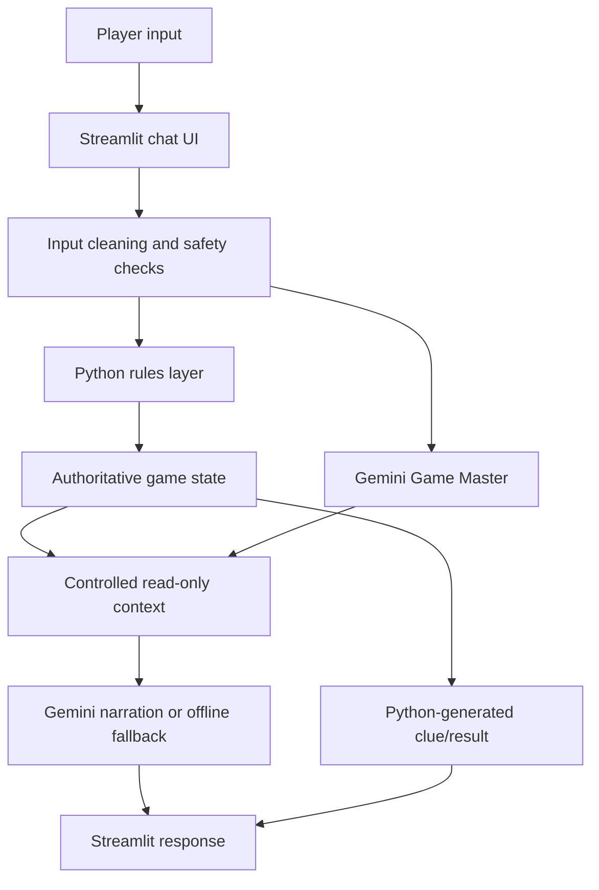

# Architecture — NVIDIA: THE FALL

## Version 1: Streamlit



The rules layer parses a player's natural-language command and determines the action. Gemini narrates the result; Python supplies the authoritative clue and state change. The final report documents one room, six interactable objects and three clues.

## Version 2: FastAPI + browser client

```mermaid
flowchart TD
    A[Player] --> B[HTML/CSS/JavaScript client]
    B -->|POST /api/act/{action_name}; X-Session| C[FastAPI]
    C --> D[Validate request, action and session]
    D --> E[Python Game engine]
    E <--> F[Session state]
    E <--> G[server/content.py]
    E --> H[Validated result]
    B --> I[Gemini narration / hint request]
    I --> J[server/gm.py safety layer]
    J --> K[Gemini text or offline fallback]
    H --> B
    K --> B
```

The engine owns state, evidence collection, puzzle validation, room progression, timer and scoring. The browser sends actions; it does not decide whether an action succeeds. Gemini cannot change state.
